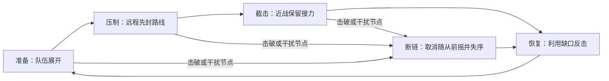

# 猎网协议：战斗如何产生取舍

v0.4 将战斗重点放在观察、诱导、转向、选择目标与反击窗口。普通群体制造压力，指挥编队改变路线，特殊单位要求不同的处理方式。玩家成型后仍应感到强大，但单一圆周路线不应解决所有威胁。

## 读懂一轮围攻

一轮约 6.9 秒，阶段长度依次为 1.15 / 1.90 / 2.20 / 1.65 秒。每个节点独立指挥自己的队伍，HUD 展示最近节点的阶段。节点被摧毁时，已经进入蓄力的关联攻击会取消；正在生效的独立危险区仍需避开。

## 决策与代价

| 观察到的情况 | 可选行动 | 需要权衡 |
| --- | --- | --- |
| 网络识别连续弧线 | 反向、切内圈、留回声诱饵 | 反向可能接近追踪群，要观察空隙 |
| 压制即将转为截击 | 留冲刺应对第二波 | 也可提前突进拆节点，但要承担近身压力 |
| 棱镜正面对准你 | 诱导其转身，再冲刺到侧背 | 正面硬打仍可杀死，侧背更高效且能取消前摇 |
| 维护者正在连线修复 | 点选集火或冲刺干扰 | 集火支援时，眼前的截击者可能逼近 |
| Boss 环震预告 | 留内圈或离开外圈 | 不要把所有圆形都当成“离中心越远越安全” |
| Boss 攻击后核心暴露 | 趁恢复期输出 | 仍要避开上一招残留区域和其他敌人 |

## AI 能知道什么

轨迹估计使用已发生的位移、速度变化和持续转向；高速位移作为冲刺已经发生的证据。诱饵影响下一次选定目标，已经锁定的预告不会突然改向。怪物不会读取未来输入，也不会读取玩家冲刺冷却来安排必中的攻击。

这是一套本地状态机和有界决策，不是在线学习模型。编队决策每约 0.22 秒更新；碰撞和模拟维持 60 Hz。特殊攻击总并发受限，危险区的伤害与显示共用形状数据。逃离检查评估原地、短移、长移候选路径，不承诺所有拥挤和弹幕组合都能无伤逃出。

## 成型后的敌人如何继续发挥

精英棱镜卫在较远距离开始准备，由盾卫实际掩护；其装甲通过朝向而非锁血保持威胁。玩家仍能用侧背攻击、干扰、灼烧和更好的火力分配将其提前击破。维护者给忽视后排的战斗增加续航，但被持续火力压制时不会强行完成治疗。

生命和伤害的时间增长均有上限，采用新攻击形态和职责组合延长策略空间。完整三系成长依然保留；本轮未扩展地图探索、装备仓库和联机，以免稀释已经可玩的战斗验证。

## 验证目标

同构筑、同种子条件下，固定绕圈与预告后反应应产生不同的伤害结果；打断、绕背和抓恢复窗口必须真正改变生命值。详见 `dev/v04-validation.md`，包含不死长局稳定性与真实 100 HP 路线对照的区别、测试数据和已知边界。
