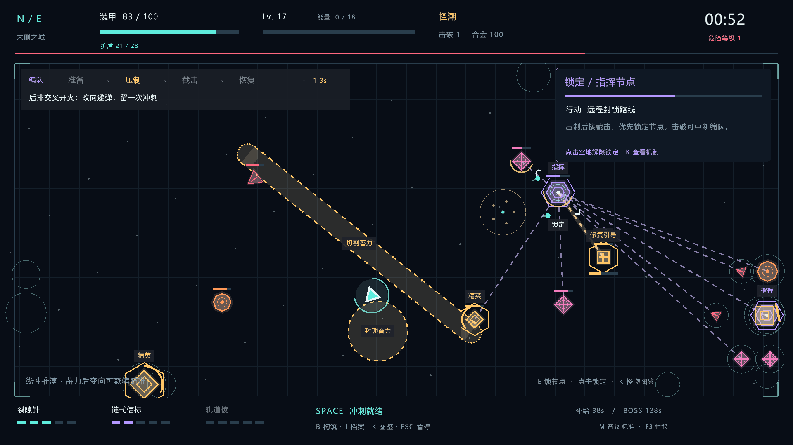

# 霓虹余烬 · 未删之城 v0.4「猎网协议」

## 历史版本下载

仓库的 [`history/`](history/) 目录保留 v0.1 到 v0.4：v0.1 为浏览器原型，v0.2–v0.4 为 Windows x64 免安装客户端。

Windows 64 位免安装动作肉鸽客户端。单人离线、无尽生存、自动攻击与主动冲刺，保留霓虹几何风。v0.4 重点解决持续绕圈能规避多数威胁、成型后特殊敌人来不及行动的问题：加入弧线预判、四阶段协作、两种机制精英与多形态 Boss。

画面按窗口实际像素重绘，最高 2560×1440；提高中文字库分辨率，增加怪物图鉴、目标行动与破解提示。旧版 720p 画面不再被直接放大。演示截图固定为 1920×1080。

## 开始游戏

将压缩包**完整解压**，双击 `NeonEmber.exe`。请保留同目录的 `raylib.dll`，不要只把 exe 拿出来。

适用 Windows 10/11 x64，需要 .NET Framework 4.8 和支持 OpenGL 3.3 的显卡驱动。玩家不需要安装 Node.js、Python、浏览器或游戏引擎，也不需要联网。Node.js 仅用于开发 MCP。

## 操作

| 按键 / 操作 | 作用 |
| --- | --- |
| WASD / 方向键 | 移动；武器自动攻击射程内目标 |
| 空格 | 沿移动方向冲刺；静止时沿上次移动方向，带短暂无敌并触发已有冲刺改装 |
| E | 优先锁定最近指挥节点；没有节点时选最近敌人，再次选中同一目标则解除 |
| 点击敌人 / 空地 | 手动设为优先攻击目标 / 解除锁定；仍受武器射程限制 |
| 1 / 2 / 3 | 选择升级卡，也可鼠标点击 |
| R | 刷新升级选项，初始 3 次，击破监察者可补充 |
| B | 暂停并查看武器、体系投入、觉醒与混搭协同 |
| J | 暂停并查看已解锁的记忆档案；菜单也可查看 |
| K | 暂停并打开 9 类敌人的图鉴；鼠标或方向键切换条目 |
| Esc | 暂停 / 继续；优先关闭档案、指南或构筑面板 |
| H | 操作与战斗指南 |
| M | 音效：标准 → 关闭 → 轻柔 |
| F3 | 显示性能与实体数量 |
| F11 | 切换无边框全屏 |

窗口失焦会自动暂停。升级、补给、档案、指南、构筑和暂停界面不推进战斗时间。暂停菜单可关闭屏幕震动。

## 敌人会怎样配合

敌人依据玩家**已经发生的移动和转向**预测位置。反复朝同一方向绕圈，会逐渐被识别为弧线路径；变向、切入内圈和诱饵会改变判断。网络观察到冲刺后，会调整接力截击；它不读取尚未执行的按键，也不偷看冲刺冷却。

指挥节点以「准备 → 压制 → 截击 → 恢复」组织队伍。远程先封路线，近战保留后续进攻，玩家需要决定何时交冲刺、是否先拆节点，以及何时利用恢复期反击。画面左上显示最近编队的阶段；锁定目标后，右上显示其行动与破解方法。

- **指挥节点**维持队伍组织；优先击破或干扰节点，可以打断关联随从的蓄力，令它们短暂失联并进入恢复期。
- **盾卫**移动到火力手或节点前方提供掩护。保护依赖实际站位，可以绕侧翼、用干扰使其失效，或以破阵冲刺制造缺口。
- **截击者**从两侧向预测路径靠近，并在预告后冲锋。匀速直走容易被截住，诱导预判后反向或冲刺更有效。
- **火力手**拉开距离，在协同时形成交叉火力；**封路者**留下有预告的危险区域，逼迫玩家重新选择路线。
- **棱镜卫**有转向速度受限的正面装甲。正面承受 35% 伤害，侧面 110%，背面 145%；蓄力时从侧背打出足够伤害，可以取消其突刺。干扰和攻击后的恢复期会关闭护甲。
- **维护者**为受伤盟友引导修复。直接命中或干扰可以打断；持续点燃会阻止它启动下一次修复。治疗量和频率有限，不会复活敌人。
- **监察者**交替使用圆形封锁、线形切割与带安全内圈的环形震荡。半血后线形切割变为平行双线，攻击后暴露的核心承受额外 35% 伤害。

橙色虚线是蓄力，红色实线是生效区域，青色/白色为玩家攻击。攻击进入预告后固定落点。盾卫、维修束、棱镜护面各有独立图形提示，详细识别方式可按 K 查看。

敌方同时进行特殊攻击最多 3 个，危险区有容器上限；后期血量与伤害增长有边界。精英通过更早准备、掩护和特殊机制获得出手机会，也能被提前击破或打断。没有强制无敌或锁血阶段。AI 使用本地轨迹估计与状态决策，不依赖网络模型。

## 世界观与剧情

暮环城依靠「总档案」保存居民记忆，却逐渐把异议和求援记录一并校订。你是信使「零」，携带一段未经修改的记忆；匿名委托的收件地址，竟然指向自己的家。

修补匠「弥」为你联络三个人类组织。击破第 1、2、3 位监察者，依次解开身份、协议与委托的真相。解锁时只显示提示，不自动打断战斗；按 J 自行阅读。已解锁档案会保存在本地，后续开局仍可查阅。

剧情揭晓后继续无尽生存：维持广播，让更多被隔离的街区收到证词。完整设定、剧情内容和技术说明见 [WORLD.md](WORLD.md)，其中包含剧透。

## 三套构筑体系

| 组织 / 初始核心 | 起始技术 | 主要玩法 |
| --- | --- | --- |
| 余烬公社 / 焚档·裂隙针 | 热写烙印 1 级 | 点燃、惩罚敌人蓄力与恢复空档、死亡传火 |
| 回声潜网 / 回声·链式信标 | 离线替身 1 级 | 冲刺残像、干扰指挥、多武器交替共鸣 |
| 铸城工坊 / 铸卫·轨道棱 | 巡夜护层 1 级 | 可再生护盾、冲刺破阵、自动拦截敌弹 |

每系 3 项技术，共 **9 项体系升级**，每项最多 3 级。同系累计 **6 点自动觉醒**；最高可投入 9 点。起始技术计入体系点数，武器等级不计入。三系可以自由混搭。

- 余烬觉醒「不灭余烬」：延长点燃，燃烧敌人死亡产生爆发。
- 回声觉醒「离线人格」：冲刺残像消散时再次干扰附近敌人。
- 铸城觉醒「巡夜城墙」：增加护盾容量，破盾时抵消溢出、清弹并短暂无敌，有触发冷却。

两系各投入 **2 点**会激活协同：余烬＋回声提高对受干扰目标的燃烧伤害；余烬＋铸城通过燃烧击杀回复已有护盾；回声＋铸城增加护盾容量，残像存在时立即开始回充。卡牌和 B 面板显示具体效果。

三种武器仍可同时持有，5 级进化。升级在可用时保留武器路线与体系路线，并提供第三项选择；传火需要先有火种，共鸣需要先有至少两种武器。通用火力、攻速、生命、经验等改装继续保留。满构筑后仍有无尽成长与恢复奖励。

## 单局节奏与本地记录

战斗持续循环游猎、怪潮和喘息；每 90 秒进入补给，可领取免费恢复、购买改装。每 180 秒触发监察者登场；已有监察者时不再叠加，补给等待战场上的监察者被击破。剧情由实际击破推进，时间到达本身不解锁档案。

标准与挑战难度分别记录最高生存时间。设置、纪录和最高档案进度保存在 `%LOCALAPPDATA%\NeonEmber\profile.txt`，不联网。新一局重置战斗构筑；目前不支持保存半途战局、局外属性成长、联机或手柄。

## 性能与验证

客户端采用 C# 战斗逻辑与 raylib 5.5 原生 GPU 绘制，使用固定 60 Hz 模拟、空间网格碰撞、文本与字体缓存、有限特效和实体上限。经验球达到上限时合并数值，协同决策按固定间隔更新。升级、暂停和阅读档案不会销毁或重复创建主循环。

59 项行为和回归检查通过：26 项核心、23 项战术/体系、10 项新机制。另对旧版和新版运行 21 组同种子、同构筑路线。在带余烬觉醒的三种子诊断中，旧版固定圆周均存活 300 秒；新版固定圆周约 181–188 秒失败，观察预告后反向冲刺均存活 300 秒。

这些测试证明决策可以改变结果，不代表真人难度或所有流派的胜率。持续燃烧构筑能够压制维护者治疗，盲目锁定远处节点也未必更安全。完整方法、数据和限制见 [v0.4 对照报告](dev/v04-validation.md)，机制设计见 [DESIGN.md](DESIGN.md)。

`stress` 是固定实体数量的独立渲染夹具，报告记录渲染提交及呈现耗时；它不是完整战斗帧率保证，也不是与旧版的同条件性能对照。实际表现取决于运行机器和显卡驱动。

## 源码与开发 MCP

| 文件 | 职责 |
| --- | --- |
| `src/Game.cs` | 战斗循环、武器、经验、商店与升级 |
| `src/Tactics.cs` | 移动观察、协同队伍、掩护、预判与封路 |
| `src/World.cs` | 世界设定、体系机制、剧情解锁 |
| `src/Program.cs` | 原生窗口、渲染主循环、声音、存档 |
| `src/WorldUi.cs` | 战术可视化、目标锁定、体系与档案界面 |
| `src/Native.cs` | raylib 绑定 |

`build.ps1` 可使用 Windows 的 .NET Framework C# 编译器重新构建。`dev/mcp-server.cjs` 提供游戏专用 stdio MCP，支持构建、两类测试、场景截图和状态查询；详见 [MCP 接口说明](dev/MCP.md)。这些开发操作可直接调用接口，不需要 Computer Use。

几何图形与合成音效由程序生成；中文使用运行机器的系统字体，不分发系统字体文件。raylib 许可证见 `raylib-LICENSE.txt`。
